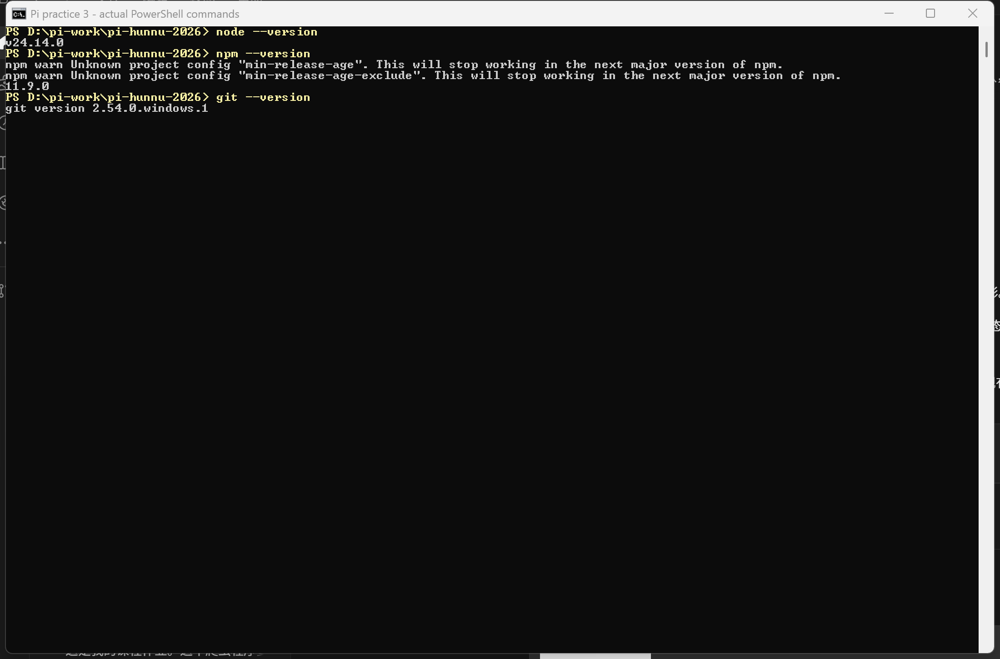
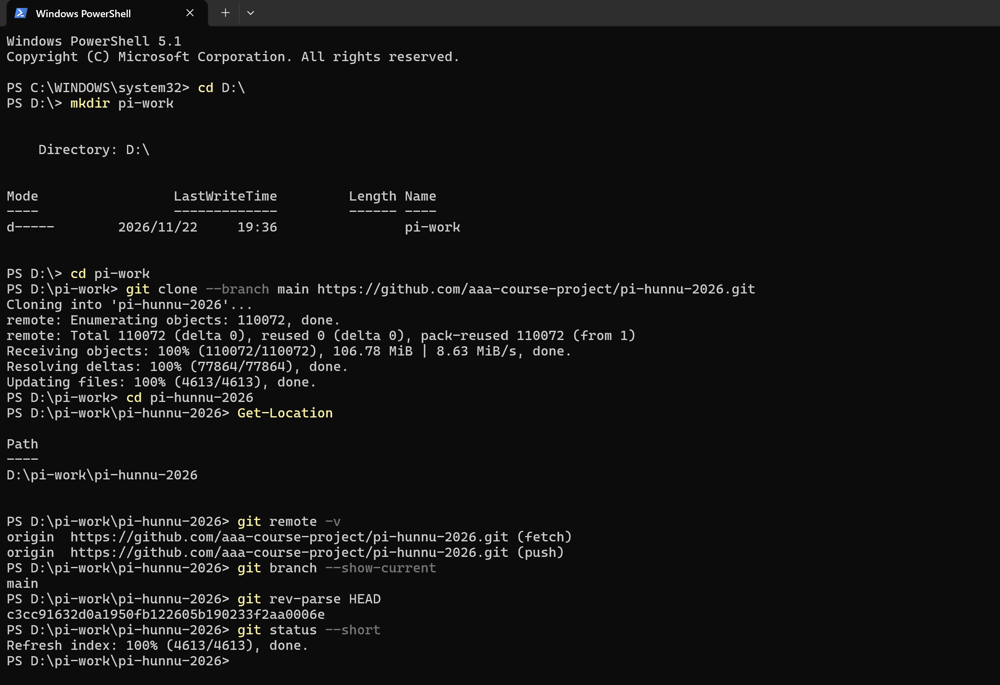
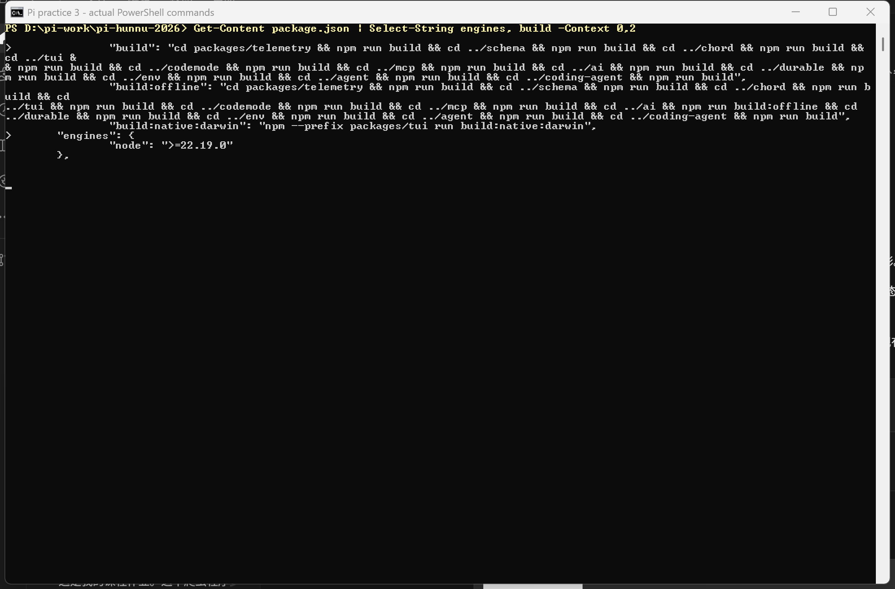
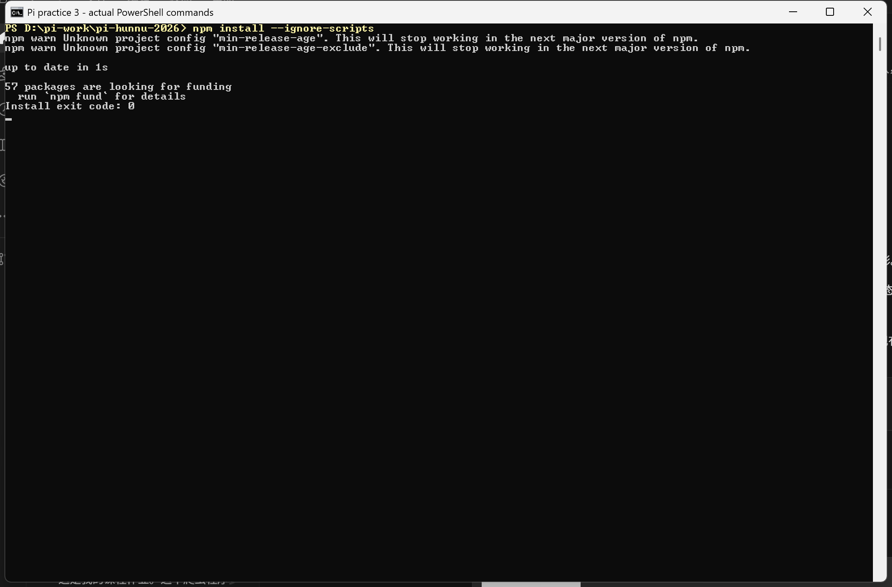
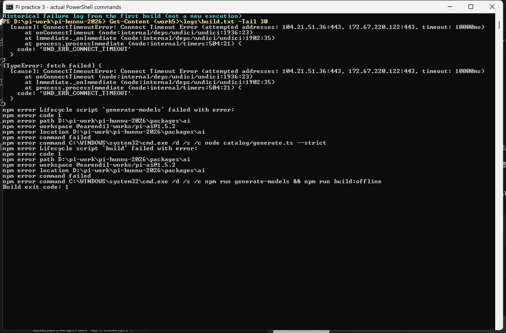
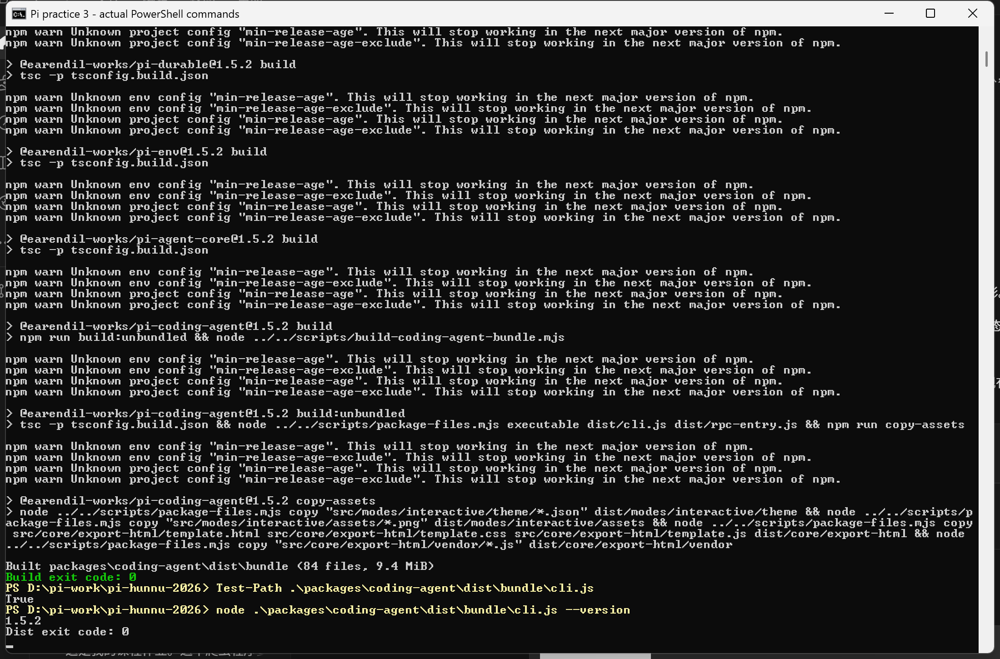
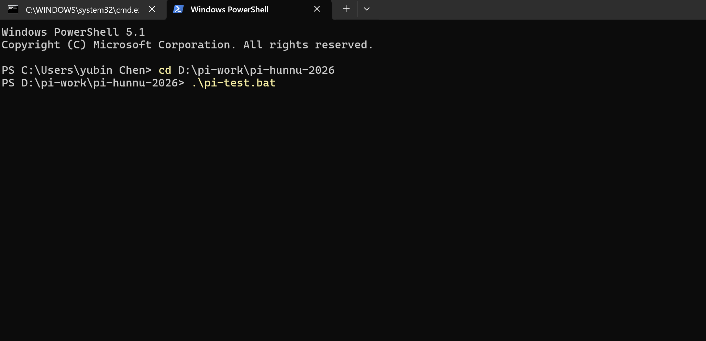
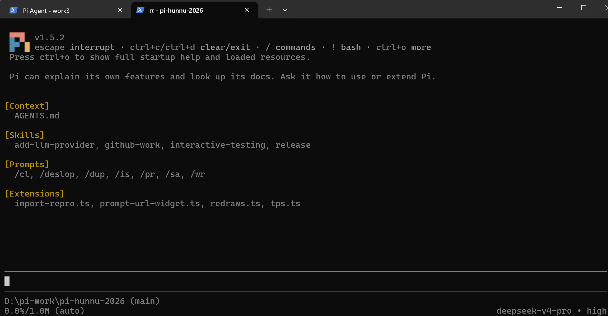
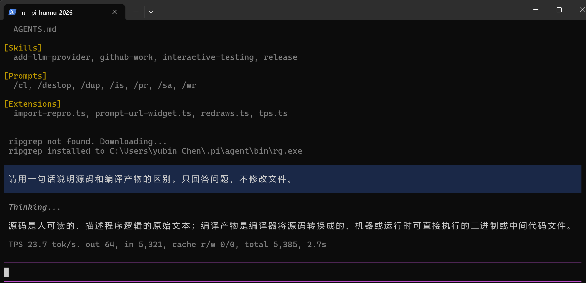

# 实践课3：Pi Agent 源码安装与编译

姓名：陈宇斌  
个人仓库：https://github.com/Chenyubin-lang/work5  
小组仓库：https://github.com/aaa-course-project/pi-hunnu-2026  
实际 clone 地址：https://github.com/aaa-course-project/pi-hunnu-2026.git  
源码目录：`D:\pi-work\pi-hunnu-2026`  
分支：main  
提交：`c3cc91632d0a1950fb122605b190233f2aa0006e`

截图说明：S1、S3、S4、S5 已替换为实际 PowerShell 窗口截图，版本检查、安装及完整构建均重新执行。故障截图是在真实终端中查看首次失败的历史日志，没有人为重现网络故障。S2 沿用实践课2的仓库截图，S6 为实际启动和对话截图。

## 1. 实验环境与源码

沿用实践课2下载的小组仓库，没有重新 clone 或覆盖目录。本次检查 Node.js 为 v24.14.0、npm 为 11.9.0、Git 为 2.54.0.windows.1。开始前工作目录干净。

环境与仓库信息见 [environment.txt](logs/environment.txt)。





## 2. 配置阅读

根 `package.json` 的 `engines.node` 声明 `>=22.19.0`。当前 Node.js 24.14.0 满足此要求。根目录 `workspaces` 定义多个工作区，`package-lock.json` 记录依赖版本及关系，应在根目录统一安装。

`npm run build` 读取当前目录 `package.json` 的 `scripts.build`。根脚本依次进入 telemetry、schema、chord、tui、codemode、mcp、ai、durable、env、agent、coding-agent，调用每个模块的 build；`&&` 表示前一步成功才继续。多数模块执行 `tsc -p tsconfig.build.json`，AI 包还获取并生成模型目录数据，coding-agent 还复制资源并打包。CLI 包 `bin.pi` 指向 `dist/bundle/cli.js`。

依据：根 README 的 Development、根 package.json，以及 packages/ai/package.json 和 packages/coding-agent/package.json。



## 3. 安装依赖

在源码根目录执行 `npm install --ignore-scripts`，退出码为 0，输出 `added 335 packages in 46s`。该命令安装本项目和工作区所需依赖并关联本地工作区包；依赖主要位于仓库的 node_modules，也可能在子工作区形成目录。没有使用 `-g`，不会替换全局 pi。

`--ignore-scripts` 跳过安装生命周期脚本，包括 prepare、postinstall 等；后续主动执行的 build 仍可以运行。安装使根 package-lock.json 产生变化，已保留，未提交至小组仓库。

本次输出含未知配置警告和 deprecated 提示，未见 EBADENGINE；安装汇总未给出漏洞审计数字，因此不能写成“0 vulnerabilities”。未执行 npm audit fix --force。

完整首次安装日志：[install.txt](logs/install.txt)。截图为之后在已有依赖上再次执行安装的结果，因此最终截图显示 up to date，退出码仍为 0，与首次新增 335 个包的汇总不同。



## 4. 首次构建与困难处理

首次执行 `npm run build`，在 AI 包获取 models.dev 目录时出现 `UND_ERR_CONNECT_TIMEOUT`，根构建退出码为 1。此时虽然前面的模块已完成编译，仍不能认为整个仓库成功。

排查发现 Windows 已启用本地代理，但 Node.js 的 fetch 没有使用它。为当前构建进程设置以下变量：

```powershell
$env:HTTPS_PROXY = 'http://127.0.0.1:7890'
$env:HTTP_PROXY = 'http://127.0.0.1:7890'
$env:NODE_USE_ENV_PROXY = '1'
```

使用 Node.js 的 `--use-env-proxy` 请求 models.dev 后返回 HTTP 200。再运行完整的 `npm run build`，模型目录生成完成，后续模块编译与打包全部结束，输出 `Built packages\coding-agent\dist\bundle (84 files, 9.4 MiB)`，根构建退出码为 0。此代理地址来自本机实际设置，其他电脑应按自己的网络配置使用。

首次失败日志：[build.txt](logs/build.txt)。解决后成功日志：[build-proxy.txt](logs/build-proxy.txt)。



解决后的完整构建退出码见下方 S5 证据图。

另一个现象是 npm 多次提示不识别 `.npmrc` 中的 `min-release-age`、`min-release-age-exclude`。这属于配置兼容性警告，当前命令仍正常结束，本次保留配置、没有为消除警告改动课程源码。安装还提示 prebuild-install 与 node-domexception 弃用，应与阻止命令完成的错误区别记录。

## 5. 编译产物验证

执行：

```powershell
Test-Path .\packages\coding-agent\dist\bundle\cli.js
node .\packages\coding-agent\dist\bundle\cli.js --version
.\pi-test.bat --version
```

结果依次为 True、1.5.2、1.5.2，两个版本命令均退出 0。由此确认编译产物存在且能运行，源码入口也能运行。



源码位于 src，编译结果位于 dist；以后修改功能应改 src 再构建，不直接改可能被覆盖的 dist 文件。首次构建获取的是模型目录和能力等配置，不是大模型权重。已有且有效的模型目录准备好后，可通过 `npm run build:offline` 复用数据重新编译。

## 6. 本地源码对话验证

按本次实验步骤启动 Pi 后，发送“请用一句话说明源码和编译产物的区别。只回答问题，不修改文件。”，已收到实际模型回复。下列截图分别记录输入的本地启动命令、运行界面和实际回复；命令截图为按回车执行前的画面。







本次已完成两个入口的 --version 验证，用户提供的截图也记录了实际模型回复。源码入口的 .bat 调用 .ps1，由 Node.js 加载源码解析器运行 packages/coding-agent/src/cli.ts，适合源码开发调试；dist/bundle/cli.js 用于验证打包后的运行结果。直接执行全局 pi 不能证明运行的是本地源码。

本地源码可能复用用户 ~/.pi/agent 的登录配置，复用配置不等于运行全局版本。模型调用若失败，应独立记录账号、网络或服务问题，不能据此否定此前成功的编译结果。
